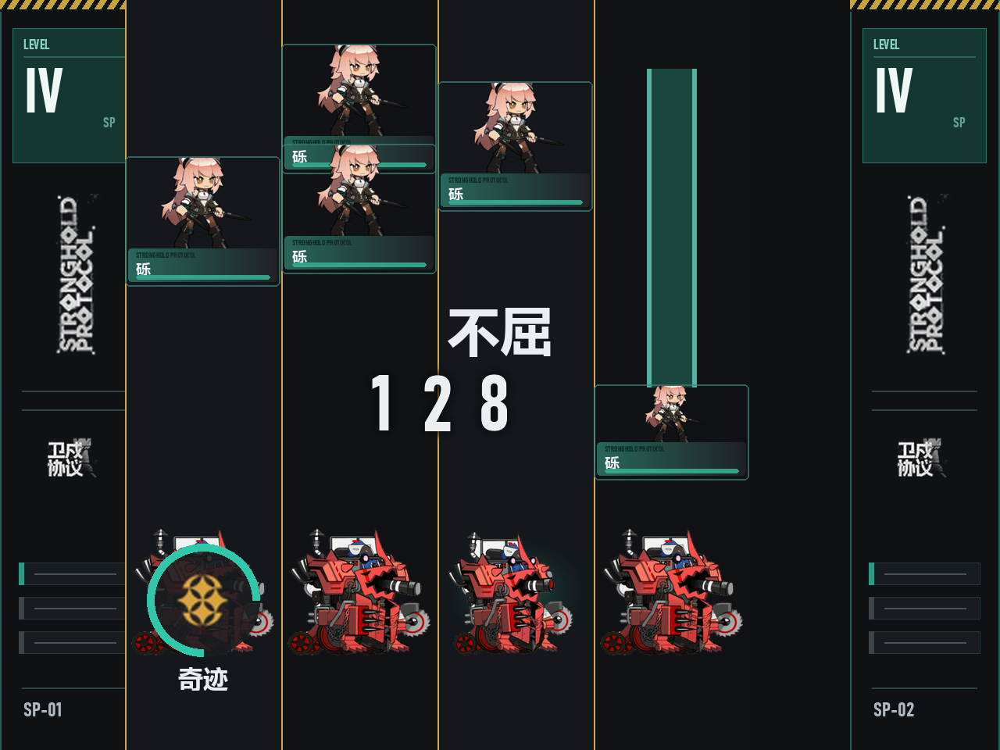

# 4K Defense Protocol · 不屈不是区

一个《明日方舟》「卫戍协议 / STRONGHOLD PROTOCOL」主题的 osu!mania 皮肤。

> 非官方同人作品。角色与 UI 素材版权归 **上海鹰角网络科技有限公司** 所有，
> 本项目仅作个人使用与学习交流，**禁止商用**。



## 特性

- **判定线**：只剩居中的「不屈」两个字，连击数字排在它正下方（标签在上、数值在下的排版）
- **音符**：透明底的干员卡（砾），青绿 1px 描边 + 立绘 + 底部渐变文本框 + 框内青绿缎带
- **按键**：暴躁铁皮，抬起 / 按下两套姿态（Idle / Skill 帧）
- **判定戳**：奇迹 / 精准 / 灵巧 / 迅捷 / 远见，青绿 + 灰双色进度环，图标居中、文字在下
- **MISS**：青绿粗边框 + 汉字「区」
- **侧栏**：黄黑警戒带 + 青色 LEVEL 块 + 竖排 STRONGHOLD PROTOCOL 字标
- **多键数**：4 / 5 / 6 / 7 / 8 / 9 / 10 / 12 / 14 / 16K 各自配置，7K 有单独的按键补偿

## 安装

**方式一**：下载 `不屈不是区.osk`，双击安装。
**方式二**：把 `skin/` 里的文件放进 `osu!/Skins/不屈不是区/`。

游戏内：`Options → Skin → 当前皮肤`。

## 目录

```
skin/                皮肤本体（放这整个文件夹的内容到 osu!/Skins/）
   skin.ini          4~16K 的完整配置
   mania-*.png       判定线 / 音符 / 按键 / 判定戳 / 舞台
   score-*.png       连击数字
   spk4*.png         4K 按键（按列宽补偿过比例）
   spk7*.png         7K 按键
   *@2x.png          高清副本，引擎按一半尺寸绘制
tools/               生成这些图片的 Python 脚本
preview.png          预览图（合成，非实机截图）
```

## 重新生成图片

图片由 `tools/_build_sp3.py` 生成（需要 Pillow 与 numpy）。
脚本**不会覆盖** `skin/skin.ini`——配置由你自己维护。

```bash
python tools/_build_sp3.py
```

脚本里几个可以直接调的常量：

| 常量 | 作用 |
|---|---|
| `STAGE_W` / `HINT_H` | 判定线贴图尺寸（与舞台矩形一致，1:1 不缩放） |
| `KEY_H` | 按键画布高度，用于抵消按键槽的纵向压缩 |
| `HINT_STRETCH` | 判定线贴图的横向拉伸补偿（当前未启用） |

> 素材（砾 / 暴躁铁皮 GIF / 卫戍协议字标）未包含在本仓库中，请自行准备后放到
> `skin/` 对应位置；脚本会从 `skin/` 与 `skin/素材参考/` 读取它们。

## 已知限制

- osu!stable 的 mania **按键层是静态贴图**，不会播放帧动画，所以按键只有抬起/按下两态。
- **连击数字无法按数值变色**——引擎只按位数取 `score-0~9.png`，没有读取数值的接口。
- 判定线贴图会被拉伸到舞台矩形，所以里面的文字必须按该比例设计。

## License

代码（`tools/`）以 MIT 发布；美术素材版权归鹰角网络所有，不在授权范围内。
